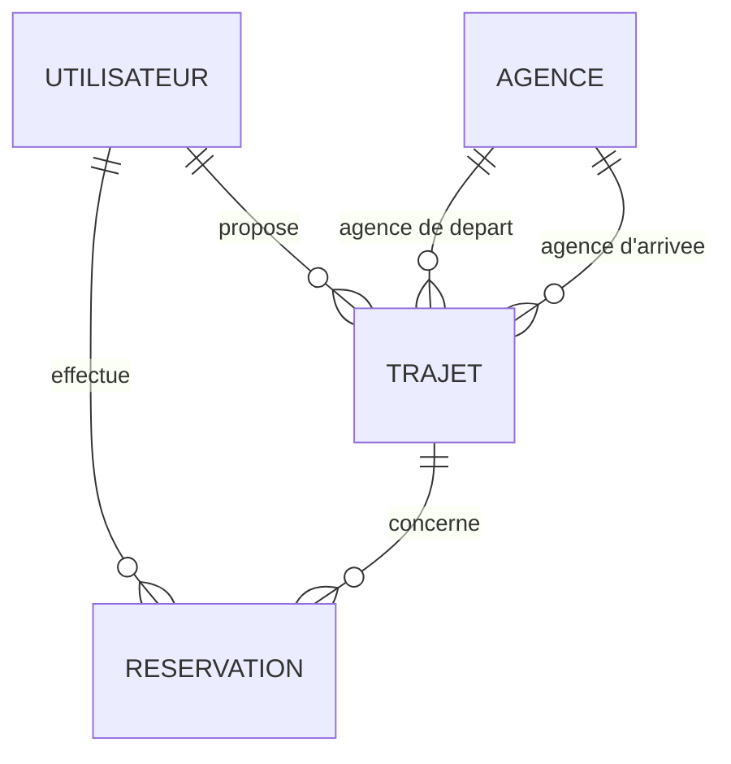

# Touche pas au klaxon — MCD et MLD

## 1. Présentation

Ce document décrit le modèle conceptuel de données (MCD)
et le modèle logique de données (MLD) de l'application
de covoiturage « Touche pas au klaxon ».

Les modèles sont établis à partir des quatre tables de la
base de données `touche_pas_klaxon` :
`utilisateurs`, `agences`, `trajets` et `reservations`.

## 2. MCD — Modèle conceptuel de données

### Entités

- **UTILISATEUR** : id, nom, prenom, telephone, email,
  mot_de_passe, role, date_creation
- **AGENCE** : id, ville
- **TRAJET** : id, date_depart, heure_depart, date_arrivee,
  heure_arrivee, nombre_places_total,
  nombre_places_disponibles, date_creation
- **RESERVATION** : id, nombre_places, date_reservation

### Associations et cardinalités

- Un utilisateur propose zéro à plusieurs trajets.
  Chaque trajet est proposé par un seul utilisateur.
- Une agence peut être le point de départ de zéro à plusieurs
  trajets. Chaque trajet possède une seule agence de départ.
- Une agence peut être le point d'arrivée de zéro à plusieurs
  trajets. Chaque trajet possède une seule agence d'arrivée.
- Un utilisateur peut effectuer zéro à plusieurs réservations.
  Chaque réservation appartient à un seul utilisateur.
- Un trajet peut recevoir zéro à plusieurs réservations.
  Chaque réservation concerne un seul trajet.

### Diagramme conceptuel



## 3. MLD — Modèle logique de données

Les clés primaires sont notées **PK** et les clés étrangères **FK**.

### UTILISATEURS

- `id` : INT UNSIGNED, PK, auto-incrémenté
- `nom` : VARCHAR(100), obligatoire
- `prenom` : VARCHAR(100), obligatoire
- `telephone` : VARCHAR(20), obligatoire
- `email` : VARCHAR(150), obligatoire, unique
- `mot_de_passe` : VARCHAR(255), nullable
- `role` : ENUM('utilisateur', 'admin'), obligatoire
- `date_creation` : TIMESTAMP, valeur par défaut courante

### AGENCES

- `id` : INT UNSIGNED, PK, auto-incrémenté
- `ville` : VARCHAR(100), obligatoire, unique

### TRAJETS

- `id` : INT UNSIGNED, PK, auto-incrémenté
- `utilisateur_id` : INT UNSIGNED, FK vers `utilisateurs.id`
- `agence_depart_id` : INT UNSIGNED, FK vers `agences.id`
- `agence_arrivee_id` : INT UNSIGNED, FK vers `agences.id`
- `date_depart` : DATE, obligatoire
- `heure_depart` : TIME, obligatoire
- `date_arrivee` : DATE, obligatoire
- `heure_arrivee` : TIME, obligatoire
- `nombre_places_total` : TINYINT UNSIGNED, obligatoire
- `nombre_places_disponibles` : TINYINT UNSIGNED, obligatoire
- `date_creation` : TIMESTAMP, valeur par défaut courante

### RESERVATIONS

- `id` : INT UNSIGNED, PK, auto-incrémenté
- `trajet_id` : INT UNSIGNED, FK vers `trajets.id`
- `utilisateur_id` : INT UNSIGNED, FK vers `utilisateurs.id`
- `nombre_places` : TINYINT UNSIGNED, obligatoire, défaut 1
- `date_reservation` : TIMESTAMP, valeur par défaut courante

Contrainte supplémentaire : unicité du couple
`(trajet_id, utilisateur_id)`. Un utilisateur ne peut donc
avoir qu'une réservation par trajet.

### Schéma relationnel synthétique

```text
UTILISATEURS(
  id PK,
  nom,
  prenom,
  telephone,
  email UNIQUE,
  mot_de_passe,
  role,
  date_creation
)

AGENCES(
  id PK,
  ville UNIQUE
)

TRAJETS(
  id PK,
  utilisateur_id FK -> UTILISATEURS.id,
  agence_depart_id FK -> AGENCES.id,
  agence_arrivee_id FK -> AGENCES.id,
  date_depart,
  heure_depart,
  date_arrivee,
  heure_arrivee,
  nombre_places_total,
  nombre_places_disponibles,
  date_creation
)

RESERVATIONS(
  id PK,
  trajet_id FK -> TRAJETS.id,
  utilisateur_id FK -> UTILISATEURS.id,
  nombre_places,
  date_reservation,
  UNIQUE(trajet_id, utilisateur_id)
)
```

## 4. Règles d'intégrité

- L'adresse e-mail d'un utilisateur est unique.
- Le nom de ville d'une agence est unique.
- Une réservation référence un trajet et un utilisateur existants.
- Une agence de départ doit être différente de l'agence d'arrivée.
- La date et l'heure d'arrivée doivent être postérieures au départ.
- Le nombre de places disponibles ne peut pas dépasser le
  nombre de places total.
- La suppression d'un trajet entraîne la suppression de ses
  réservations associées, conformément à la clé étrangère.
- Les trajets sont rattachés à leur conducteur par
  `utilisateur_id`.

## 5. Remarque

Ce document décrit les structures et contraintes observées
dans la base. Il ne remplace pas le script de création SQL
`database/schema.sql`.